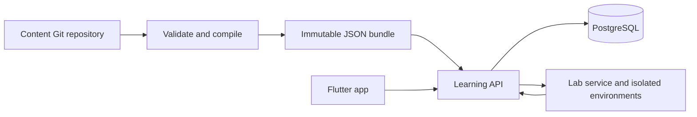

# Learning platform architecture

Status: MVP implementation baseline, documented 2026-11-04. Services and contracts are not implemented yet.

## Decision and ownership

Use a modular application API, PostgreSQL for durable learner state, versioned YAML/Markdown content compiled to JSON, and a separate lab execution boundary. The first journey is OpenShift, aligned to public DO180 and DO280 objectives. Flutter serves iOS and Android. [ADR 0001](../decisions/0001-backend-and-identity.md) selects Java/Quarkus and self-hosted Keycloak, operated by SysKata, with local development first. Hosted deployment is deferred; lab provider and runtime feasibility remain separate decisions.

| Repository | Responsibility |
| --- | --- |
| app | Presentation, accessibility, recovery state, pending submissions |
| api | Authentication integration, enrollment, sessions, grading coordination, progress, review and rewards |
| content | Original curriculum, skill IDs, prerequisites, hints, documentation references and assessment criteria |
| labs | Environment lifecycle, terminal gateway, trusted evaluators and structured results |
| docs | Cross-repository decisions, MVP scope and delivery tracking |

## Curriculum and selection

A journey contains ordered units and lessons; lessons contain exercise pools and prerequisites. Exercises reference stable skills. Model curriculum separately from learner evidence and motivation. XP is not mastery and a retry after revealing an answer is weaker evidence than independent success.

Resume an active session first. Otherwise offer due review or the next unlocked lesson. Select exercises to cover its objectives; after a mistake provide feedback and a related exercise later. Lesson completion is a versioned policy, not simply incrementing a level after every answer. Start with deterministic selection and review intervals; do not require ML or a general rules engine.

## Content delivery and versions

Author YAML metadata and Markdown prose in content. CI validates schemas, IDs, references, prerequisite cycles, evaluator support, fixtures and documentation links, then builds immutable JSON bundles. Separate learner payloads from assessment definitions. Public source content is inspectable; this is a learning product, not a secure certification exam.

Initially package the bundle with the API release. Later publish bundles and assets to object storage/CDN independently. Never query GitHub on each lesson request. Pin schema, bundle, exercise, evaluator and policy versions to sessions/attempts; retain historical bundles for active sessions and reproducibility. Deploy compatible readers before activating new schemas. Rollback switches new sessions to a previous bundle, without rewriting historical attempts.

## State and transaction boundaries

PostgreSQL owns identities/enrollments, sessions, issued exercise instances, attempts, skill evidence, review dates, reward events and lab references. Use relational keys and constraints, with JSONB for type-specific answers/results. No learner data belongs in Git.

Derive identity from authentication. The client submits the issued exercise-instance ID and answer with an idempotency key; it cannot choose its score, progress, balance or content version. Validate ownership and session state. In one transaction record the result, update progress/review/rewards and save the replayable response. Same key and payload returns the original outcome; same key with a different payload conflicts. Concurrent submissions must not double-award completion. Use row locking or equivalent concurrency control and unique business-event constraints.

Lab assessment is asynchronous. Persist an assessment job before dispatch, using a transactional outbox or equivalent durable job mechanism. Authenticate results and deduplicate by assessment ID. Infrastructure errors do not count as mistakes. The lab evaluator reports evidence; the API applies progression rules.

## Caching and recovery

Cache immutable bundles in process by version/hash. Use immutable asset URLs and a CDN if needed. PostgreSQL remains authoritative for progress and rewards; Redis is deferred until shared rate limiting or measured read load justifies it. Cache loss must not lose attempts or balances.

Mobile stores the active session, pending payload and its idempotency key durably, then reconciles on reconnect. MVP is online-first, with interruption recovery rather than offline grading. Do not display locally inferred completion as confirmed. Account switching clears or isolates per-user cached state.

## Lives, gifts and lab quotas

MVP learning, hints and review remain unrestricted by mistakes. Defer lives and social gifting. If introduced, use optional challenge modes and a PostgreSQL transaction ledger recording reason, attempt, gift, sender and recipient. Define refill/cap/expiry and sender-cost policies first. Claim once, enforce concurrency limits, and never award mastery from a gift. Lab compute quotas are separate from lives.

## Runtime and operations

Use a separately isolated OpenShift lab boundary with scoped short-lived credentials, TTLs, quotas, network restrictions and cleanup. No submitted command executes on the API host. Shared namespaces do not make cluster-administrator exercises safe; privileged operations require disposable dedicated environments or remain deferred.

Provide migrations, backups with restore verification, structured logs without credentials/answer leakage, correlation IDs, health checks, metrics for submissions/assessment failures, and staging end-to-end tests. Keep original attempts immutable except defined account-deletion/retention processing. Track curriculum effectiveness by skill and exercise version; analytics must not block submission success.

## References and rationale

The existing component ownership is retained. Duolingo publicly describes authored course structure with personalized exercise selection and spaced review; these inform learning behavior, not a claim about its private infrastructure:

- [Course creation and personalization](https://blog.duolingo.com/how-duolingo-experts-work-with-ai/)
- [Spaced repetition](https://blog.duolingo.com/spaced-repetition-for-learning/)
- [Evolution from hearts to Energy](https://blog.duolingo.com/duolingo-energy/)

See [MVP scope](../plans/openshift-mvp.md) and repository-specific implementation documents.
